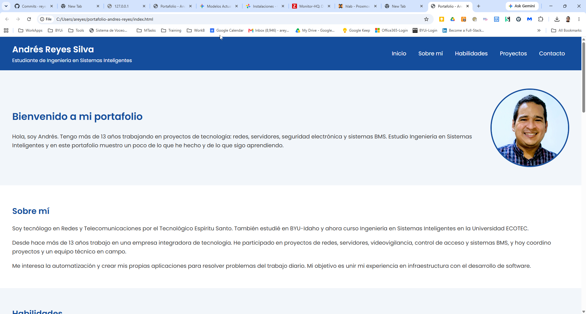

# Portafolio personal

**Estudiante:** Andrés Reyes Silva
**Carrera:** Ingeniería en Sistemas Inteligentes - Universidad ECOTEC
**Asignatura:** Programación de Sistemas Web - Actividad Integradora 1

## Descripción

Este es mi portafolio personal. Tiene una sección de inicio, información sobre mí,
mis habilidades, algunos de los proyectos en los que he trabajado (videovigilancia,
monitoreo, aplicaciones e infraestructura) y un formulario de contacto.

## Tecnologías utilizadas

- HTML5 (etiquetas semánticas: header, nav, main, section, article, footer)
- CSS3 (flexbox, variables en :root, :hover y media queries)
- Google Fonts (fuente Poppins)
- Git y GitHub

## Cómo ver el proyecto

**Opción 1:** abrir la página publicada en GitHub Pages:
https://reyes-andres.github.io/portafolio-andres-reyes/

**Opción 2:** en tu computadora:

1. Descargar o clonar el repositorio:
   ```
   git clone https://github.com/reyes-andres/portafolio-andres-reyes.git
   ```
2. Abrir la carpeta `portafolio-andres-reyes`.
3. Hacer doble clic en `index.html` para abrirlo en el navegador.

## Estructura

```
portafolio-andres-reyes/
├── index.html
├── styles.css
├── README.md
└── img/
```

## Captura de pantalla



## Referencias

- Presentaciones de la clase de Programación de Sistemas Web (ECOTEC)
- MDN Web Docs: https://developer.mozilla.org/es/
- W3Schools: https://www.w3schools.com/css/
- CSS-Tricks, A Complete Guide to Flexbox: https://css-tricks.com/snippets/css/a-guide-to-flexbox/
- Google Fonts: https://fonts.google.com/
- GitHub Docs (GitHub Pages): https://docs.github.com/es/pages
